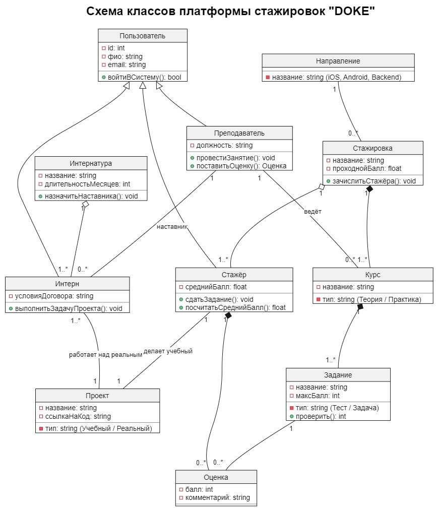

# Test-assignment-for-a-backend-role
Это репозиторий для выполнения задания КТ2 по роли Backend-разработчик.

**Задание выполнила:** Гачегова Ирина, ИТ-12

**Основная роль:** Бэкенд

**Смежная роль:** Системный аналитик

**Ссылка на задание:** https://github.com/Hexlet/ru-test-assignments/blob/main/backend/kode/2018-internship-backend.md

## Что сделано, а что нет
### Сделано
- **Задача №1. Определение связей пользователей (C++):**
  - Реализована функция `check_relation`, которая проверяет, знакомы ли два человека напрямую или через цепочку общих друзей (используется обход графа в ширину - BFS)
  - Добавлен консольный ввод имён с проверкой на ошибки (запрет цифр и проверка, есть ли человек в списке друзей)
  - Поиск сделан нечувствительным к регистру букв (Ваня и ваня считаются одним человеком)

- **Задача №3. Проектирование структуры классов платформы «DOKE» (UML):**
  - Выделены основные сущности системы (стажёры, преподаватели, курсы, задания и др.)
  - Подготовлена UML-схема классов в графическом редакторе

### Не делаю и почему
- **Задача №2 (HTTP API с погодой):** не выполняется, так как я пока не умею создавать веб-серверы и работать с внешними API через интернет. Чтобы уложиться в сроки, я сосредоточилась на задачах по алгоритмам и проектированию архитектуры
- **Усложнения в Задаче №1:** не делаю чтение списка друзей из файлов - все связи хранятся в памяти программы, как и предусмотрено базовым условием

---

## Структура проекта
- `main.cpp` - основная программа с алгоритмом поиска связей, тестами и консольным меню
- `Input.h` - вспомогательный класс для безопасного чтения строк из консоли и перевода текста в нижний регистр
- `diagram.jpg` — графическая схема классов
---

## Как запустить задание №1 через Visual Studio
1. Скачайте файлы `main.cpp` и `Input.h`
2. Создайте пустой проект C++ в Visual Studio и добавьте в него оба файла
3. Нажмите **F5** (или **Ctrl + F5**) для сборки и запуска
---

## Как проверяли
1. **Автоматические тесты из задания:** при каждом запуске программы автоматически выполняются 7 проверок (`assert`) на тестовом наборе друзей из условия задачи (например, проверка связи между Петей и Стёпой, Машей и Петей, а также отсутствия связи между Ваней и Димой)
2. **Ручное тестирование в консоли:** проверялся ввод существующих и несуществующих имён, ввод имён с маленькой буквы и ввод чисел вместо имени
---

## Задача №3. Проектирование структуры классов платформы «DOKE»

UML-диаграмма классов выполнена в редакторе **draw.io**:

### Как работает сама платформа «DOKE» (логика из условия)
1. Компания открывает **Стажировку** по разным **Направлениям** (`iOS`, `Android`, `Backend`)
2. Человек записывается, получает приглашение и становится **Стажёром**
3. Внутри стажировки есть **Теоретический курс** (лекции и **Тесты**) и **Практический курс** (занятия и **Задачи**). Ведут их **Преподаватели** (сотрудники компании)
4. За каждый тест и задачу стажёр получает **Оценку**. Из этих оценок складывается его средний балл
5. Делая практические задачи, стажёр собирает свой **Учебный проект** (пока он не работает над реальными проектами компании)
6. Если стажёр набрал высокий средний балл и успешно закончил стажировку, он переходит на следующий этап - **Интернатуру** - и становится **Интерном**. Теперь он работает над **Реальным проектом** компании под присмотром наставника

### Пояснения к диаграмме (принципы ООП)
- **Наследование (стрелка с пустым треугольником):** чтобы не дублировать одинаковые поля (`id`, `фио`, `email`), создан общий родительский класс `Пользователь`, от которого наследуются `Стажёр`, `Интерн` и `Преподаватель`
- **Композиция (закрашенный ромб):** показывает жёсткую связь «часть не существует без целого» - если удалить `Стажировку`, исчезнут её `Курсы`, а при удалении `Курса` исчезнут его `Задания`
- **Агрегация (пустой ромб):** показывает свободную связь «часть может существовать отдельно» - `Стажёр` и `Интерн` входят в программы обучения, но остаются самостоятельными пользователями после их окончания

Цифры на концах линий (1, 0..*, 1..*): показывают количество объектов в связи:
- 1 (ровно один): например, учебный Проект делает 1 конкретный Стажёр
- 0..* (от нуля до бесконечности): например, у Направления сейчас может быть 0 открытых стажировок, а завтра станет 2 или 5
- 1..* (от одного до бесконечности): например, в Курсе не может быть ноль заданий - там должно быть хотя бы 1 задание или больше
